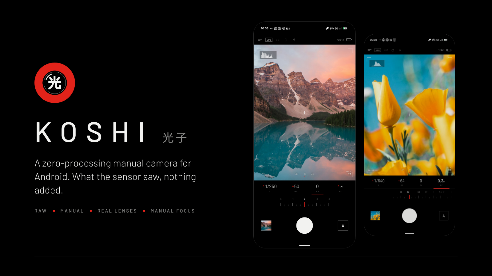
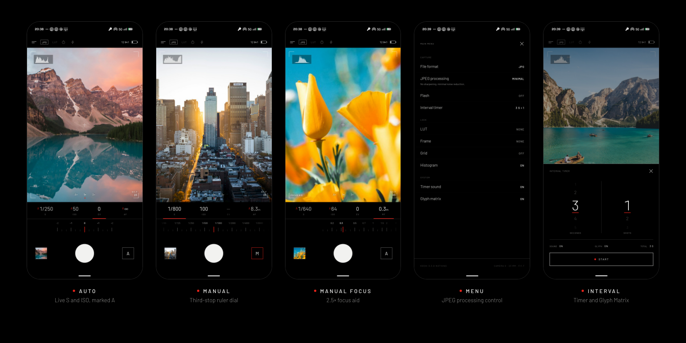
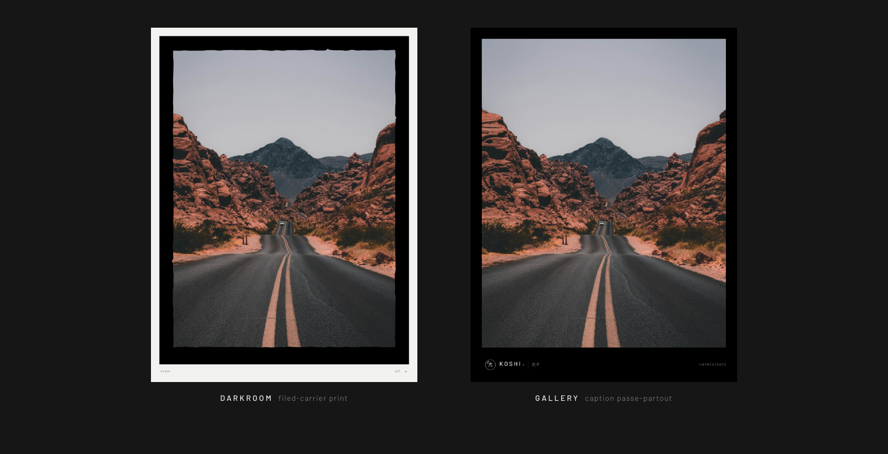

  

<h1 align="center">Koshi 光子</h1>

  A zero-processing manual camera for Android. What the sensor saw, nothing added. 
  光子 (kōshi) is Japanese for <i>photon</i>, a particle of light. Formerly <b>HeyCam</b>.

  <a href="../../releases/latest"><b>Download the latest release</b></a>

## The story

I was tired of every phone's camera app processing photos behind my back: AI "enhancements", aggressive noise reduction, over-sharpening. I wondered: **could I build a camera app with zero processing?**

The goal is simple: capture what the lens and sensor actually see, as fast as possible, with nothing in between. That camera is **Koshi**.

## Features

### 🎛️ Exposure, the way a camera shows it
* An **S · ISO · EV · focus** readout sits under the viewfinder. In Auto, the shutter speed, ISO and focus distance the camera actually chose are shown live, marked with a red **A**.
* A **ruler dial** in third stops controls shutter, ISO and exposure compensation, limited to what your sensor supports.
* **Tap S or ISO** in Auto to switch to Manual, starting from the metered exposure. Tap EV to go back.

### 🔭 Real lens switching
* **.6× / 1× / 3×** stream straight from the ultra-wide, main and telephoto sensors. They switch lenses; they don't crop.
* Many phones hide their multi-camera from apps. On the Nothing Phone (3) the real one is camera id 4, over sensors 0 / 2 / 3; Koshi finds it and locks the stream to the sensor you pick. Needs Android 10 or newer.

### 🔗 QR links
* Point the viewfinder at a QR code and a small button with the link's address appears above the lens picker. Tap it to open the link (http, https, mailto, tel, and FIDO passkey sign-in codes). Nothing opens on its own. Switch it off under Menu → QR scan.

### 🎯 Focus
* **Manual focus:** tap the focus cell (AF → MF) and turn the dial like a lens barrel, from the lens's closest focus to ∞.
* **Focus aid:** the centre of the viewfinder is magnified 2.5× for as long as your finger rests on the focus dial.
* **Tap to focus** locks focus at that point (AF-L), and in Auto it also meters there. **Long-press** to return to continuous AF.

### 🧪 JPEG processing control
| Mode | What the phone is allowed to do |
|---|---|
| **Minimal** (default) | No sharpening, minimal noise reduction, no distortion correction |
| **Off** | No noise reduction, sharpening, hot-pixel, aberration or distortion correction; neutral sRGB tone curve |
| **Device** | The phone's own processing, for comparison |

The viewfinder uses the same settings, so it shows what will be recorded. In side-by-side tests, Device mode adds sharpening halos and synthetic texture, while Minimal and Off keep the sensor's real detail.

### 📷 RAW (DNG)
* RAW is pure sensor data: no noise reduction, no sharpening, no tone curve. It is the only output guaranteed to be untouched, because some phones still process JPEGs even when asked not to.
* Each DNG is paired with the capture data of its own exposure and embeds the lens shading map. On multi-camera phones it carries the selected sensor's colour and noise profile.

### ⚡ Fast
* There is no focus or exposure sequence before a normal shot and no preview restart after it.
* Files are written on their own thread, so bursts never wait for the disk. On a Nothing Phone (3), a JPEG takes about 30–100 ms and a 25 MB DNG about 110 ms.

### 🖼️ LUTs & frames
* Import `.cube` LUTs. They are applied with trilinear interpolation, so skies don't band.
* Frames include **Darkroom** (a filed-carrier darkroom print) and **Gallery** (a caption passe-partout), plus the film classics.
* EXIF data is kept when a LUT or frame is applied. LUTs and frames never touch DNG files.

### ⏱️ And
* **Interval timer:** 1–30 s intervals and 1–99 shots, with a countdown ring in the viewfinder. On Nothing Phone (3) the countdown also runs on the **Glyph Matrix**.
* **Shutter:** the on-screen button, the volume keys, a camera key, or the Essential Key on Nothing phones.
* **Viewfinder tools:** live histogram and a rule-of-thirds grid.

## Install

| APK | For |
|---|---|
| `Koshi_v*-nothing.apk` | Nothing phones, Android 14+ (Glyph Matrix support) |
| `Koshi_v*-standard.apk` | Other Android phones, Android 9+ |

1. Download the APK from [Releases](../../releases/latest).
2. Allow installing apps from unknown sources.
3. Install and grant camera access. Koshi installs as an update over HeyCam.

Photos are saved to `Pictures/Koshi`.

## Under the hood
* **Language:** Java, Camera2 API.
* **Code:** `camera/CameraController` (session, per-request processing, lenses, focus), `camera/PhotoSaver` (MediaStore, DNG, LUT and frame rendering) and `camera/CaptureMatcher` (image ↔ result pairing).
* **UI:** Android Views with a custom-drawn dial, viewfinder overlay and histogram, set in [Barlow](https://github.com/jpt/barlow) (OFL).
* **Glyph:** `com.nothing.ketchum` (Glyph Matrix SDK).
* **Design sources:** the UI mockup, logo studies and frame generator live in [`design/`](design/).

---

Koshi is made for people who want control. If you prefer point-and-shoot convenience with AI enhancements, your phone's own camera app is the better choice.
